<!-- Cards in assets/ are generated by scripts/build_cards.py (header.svg and footer.svg are hand-written). -->

  

  

  

  

  

  

  
  
  
  
  
  

  

  

  

  <picture>
    <source media="(prefers-color-scheme: dark)" srcset="https://raw.githubusercontent.com/Aswin-sriram/Aswin-sriram/output/github-contribution-grid-snake-dark.svg"/>
    <source media="(prefers-color-scheme: light)" srcset="https://raw.githubusercontent.com/Aswin-sriram/Aswin-sriram/output/github-contribution-grid-snake.svg"/>
    
  </picture>

  
  
  

  

